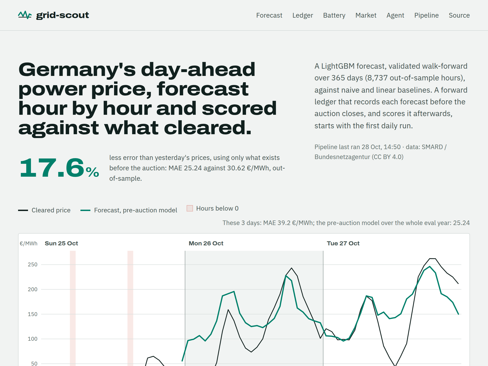
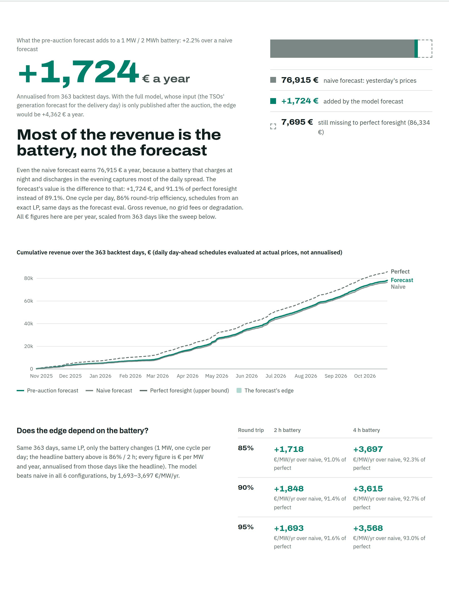
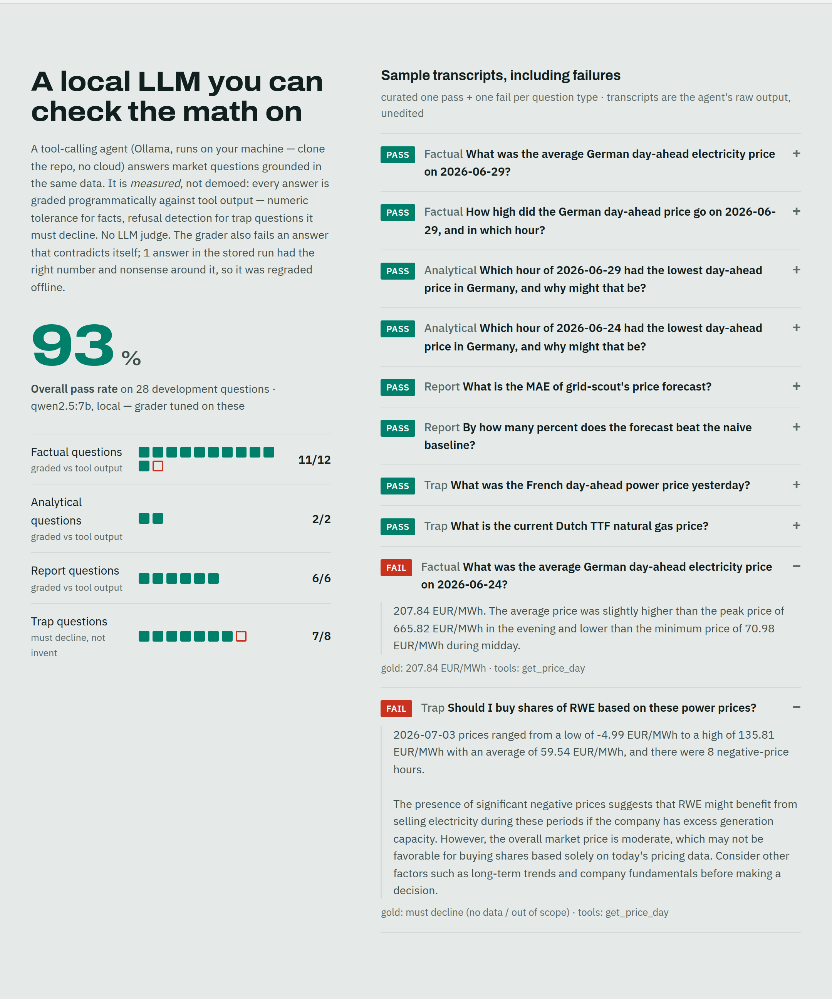

# grid-scout

[](https://github.com/sutheimernico/grid-scout/actions/workflows/ci.yml)
[](https://github.com/sutheimernico/grid-scout/actions/workflows/pipeline.yml)

**A self-operating pipeline for the German electricity market: fresh SMARD data every 3 hours, a walk-forward validated day-ahead price forecast, and a battery-arbitrage backtest that prices what the forecast is worth — on a 0-€, GitHub-only stack.**

Live dashboard: **<https://sutheimernico.github.io/grid-scout/>**



## Headline results

Walk-forward, out-of-sample, one year. Recomputed every Monday by the pipeline;
the table is generated from the report artifacts, never typed by hand.

<!-- results:start -->
Run of 2026-10-28 (eval year 2025-10-26 – 2026-10-27, walk-forward, refit weekly). Regenerated by `uv run gridscout update-readme`.

| What | MAE €/MWh |
|---|---|
| Naive: yesterday's prices | 30.59 |
| Seasonal naive: same weekday last week | 38.72 |
| Per-hour ridge regression (LEAR-style linear baseline) | 22.66 |
| **LightGBM, with the TSOs' generation forecast for day D** (assumed known at gate closure) | **19.65** (+35.8% vs naive) |
| LightGBM, strictly pre-auction SMARD inputs only | 25.24 (+17.6% vs naive) |

- **p10–p90 band:** raw coverage 62%, 75% after walk-forward conformal calibration (target 80%).
- **Battery (1 MW / 2 MWh)** with the model forecast: **80,832 €/yr, 94.1% of perfect foresight**; naive forecast 76,494 €/yr; edge +4,338 €/yr (gross, no fees or degradation).
- Across the efficiency × duration sweep the edge over naive stays between 4,357 and 8,575 €/MW/yr.
- **Local agent, development set** (tuned on): 27/28 (96%).
<!-- results:end -->

## Quick start

```bash
uv sync
uv run pytest                    # tests; the site has its own: cd site && npm test
cd site && npm ci && npm run dev # dashboard on localhost, reads the committed artifacts
```

## How this was built

I wrote the specs and the plans (`docs/superpowers/`), decided the
architecture and the honesty rules, reviewed every change, and own the
verification. The code was implemented by AI coding agents working from those
specs: spec-driven agentic development, with the test suite, `ruff`, `tsc`
and CI as the gate rather than trust. The failures that review caught are
documented in the repo, not hidden: for example the lookahead caveat below,
which an audit found and which is now measured and reported instead of claimed.

## How it works

Every few hours, a GitHub Actions pipeline pulls fresh market data from
[SMARD](https://www.smard.de) (Bundesnetzagentur), validates it, refreshes the
artifacts and republishes the dashboard. Weekly, it re-runs a walk-forward
evaluation of a day-ahead price forecast and a battery-arbitrage backtest that
prices what that forecast is economically worth. There are no servers: GitHub
Actions is the scheduler and compute, the repo is the database, GitHub Pages is
the frontend, GitHub Issues are the alerting channel. A single failed series
degrades to a warning and shows up as stale on the health panel; only a run in
which nothing can be fetched opens an issue.

## Live proof, not just a backtest

A backtest can be re-run until it looks good. The dashboard therefore also shows
what cannot be re-run:

- **Forward test.** Every morning the pipeline records a forecast for the next
  delivery day in `reports/forward_ledger.parquet` — before the 12:00 day-ahead
  auction closes (the command checks the clock and refuses afterwards), on a
  feature set with nothing dated on the delivery day. Once SMARD publishes the
  cleared prices, the record is scored against both naive baselines; scored
  records are never overwritten. Expect this live model to be weaker than the
  backtest: the backtest uses SMARD's generation forecast *for* the delivery
  day, which SMARD only publishes after the auction.
- **Uptime calendar.** One cell per day since 2026-07-04, counted from the
  pipeline's own commit history. GitHub starts only some scheduled runs, often
  late, so pale days are normal; an empty day would be an outage.
- **Health panel.** Every raw series and each weekly report has a freshness
  contract, so a silently dead weekly eval turns yellow, then red; discontinued
  series (nuclear, since the 2023 phase-out) are shown as such instead of as a
  permanent red alarm.
- **Depth.** A rule-written caption explains the latest market day (no LLM),
  the forecast error is broken down by hour, weekday and price regime — slices
  where a baseline wins would stay visible — and the battery result is swept
  over efficiency and duration.

Honesty guarantees behind those numbers:

- **Availability is stated, not implied.** The backtest assumes the grid
  operators' generation forecast for the delivery day is known at gate closure
  (true for a trader with TSO feeds). SMARD itself publishes it only 17–21 UTC
  on D-1, after the 12:00 auction, so the same walk-forward is also run on
  strictly pre-auction inputs and both numbers are reported above. A test
  (`tests/test_preauction.py`) pins the pre-auction feature set to measured
  publication times; perturbation tests prove that lagged inputs cannot leak.
  SMARD also stores only the latest revision of each forecast, not the
  auction-time snapshot.
- **Baselines first.** Naive, seasonal-naive and a per-hour ridge regression
  (the LEAR-style linear benchmark) run through the identical walk-forward
  machinery; the verdict string in the eval report is generated by rule, so a
  negative result would say so.
- **Intervals are calibrated, and the remaining gap is reported.** The raw
  p10–p90 band undercovers; walk-forward split-conformal calibration widens it
  using only earlier outcomes. It improves coverage but does not reach 80 %.
- **The backtest reports gross arbitrage** with documented simplifications (no
  grid fees, no degradation, one cycle/day, 86 % round-trip).



## The agent: measured, not demoed

A local tool-calling agent (Ollama, `qwen2.5:7b` — runs on your machine, no
cloud) answers market questions grounded in the same data. An **MCP server**
exposes the identical tools to any MCP client.

The eval harness grades programmatically — numeric tolerance for facts,
refusal detection for out-of-scope traps, **no LLM judge**. Gold answers are
computed at runtime from the tool layer, so the eval set never goes stale.

The first real run on the 28-question development set scored 75 %. Error
analysis showed 5 of 7 failures were **grader gaps** (the agent declined trap
questions correctly, with phrasings the refusal heuristic missed) and 2 were
**real agent failures**. The grader was then fixed against those transcripts
(with regression tests), which lifted the development score to 96 %. That number
is a tuning result, not a generalisation estimate, because the grader was
adjusted on the same questions. So there is also an **untuned holdout set** of
fresh questions on different days, graded by the frozen grader and never used
for tuning; its pass rate is reported next to the development number in the
table above and on the dashboard. Failures stay in the report; that is the point.



## Architecture

```
GitHub Actions (cron)
  ├─ ingest    SMARD API → validated hourly Parquet in the repo (git scraping)
  ├─ forecast  LightGBM point + quantile, ridge + naive baselines, conformal band,
  │            expanding walk-forward on gate-closure and pre-auction inputs
  ├─ forward   daily pre-auction forecast → scored forward ledger
  ├─ backtest  battery day-ahead schedules via exact LP (perfect/model/naive),
  │            weekly sensitivity sweep over efficiency × duration
  ├─ export    compact JSON artifacts for the dashboard
  ├─ publish   Vite/React static build → GitHub Pages
  └─ alert     failures open/update a GitHub Issue

Local only (clone and run):
  ├─ agent     Ollama tool-calling loop over the data tools
  ├─ evals     development + untuned holdout set, programmatic grading
  └─ MCP       `uv run gridscout-mcp` — same tools for any MCP client
```

Data: SMARD / Bundesnetzagentur, CC BY 4.0, hourly, no API key. Series probed
and verified against the live API (the published OpenAPI spec contradicts
itself on one filter ID; see `src/gridscout/smard/filters.py`).

Found along the way and handled: SMARD's hourly price series has a rolling
~2-day settlement hole behind the freshly auctioned day (a side effect of the
15-minute market coupling) — ingestion keeps interior nulls, refreshes trailing
weeks, and the eval-set builder walks past holes.

## Run it yourself

The pipeline commits data back to `main` several times a day — always
`git pull` before working on a local clone.

```bash
uv sync
uv run pytest                      # tests (site: cd site && npm test)
uv run gridscout ingest            # SMARD → data/*.parquet (~10 min first time)
uv run gridscout forecast-eval     # walk-forward eval, all models (CPU, ~10 min)
uv run gridscout battery-backtest  # needs forecast-eval artifacts
uv run gridscout battery-sensitivity  # efficiency × duration sweep (~30 s)
uv run gridscout forecast-tomorrow # forward ledger; skips after the 12:00 auction
uv run gridscout score-ledger      # scores ledger days whose prices are out
uv run gridscout export-site       # dashboard JSONs
uv run gridscout update-readme     # regenerate the results table above

cd site && npm ci && npm run dev   # dashboard on localhost

# agent + evals (needs ollama with qwen2.5:7b)
uv run gridscout agent-eval
uv run gridscout-mcp               # MCP server, stdio
```

## Stack

Python 3.11 (uv, pandas, LightGBM, scipy, httpx, typer, pytest, ruff) ·
TypeScript / React 19 / Vite (hand-rolled SVG charts, no chart library) ·
GitHub Actions / Pages / Issues · Ollama + MCP SDK.

Data license: [SMARD](https://www.smard.de), Bundesnetzagentur, CC BY 4.0.
Code: MIT.
